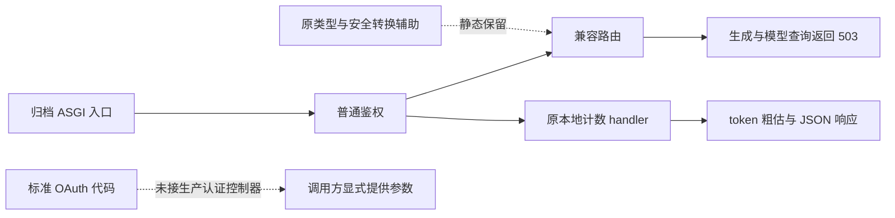

# 工程架构与归档边界

## 当前版本依据

- 上游来源：`su-kaka/agy2api`，原作者／贡献者归属与 CNC-1.0 许可保留。
- 本轮依据：当前运行镜像 `source-218ea453cf75`，镜像摘要 `sha256:324ca9bbe8118e16010ca4a595e89d18ffed4fc986c426fc7408873e2b83d1d2`。
- 镜像内版本记录：`60979cdb36fee7e63769a8b0c062f2f15d6bedbd`。运行镜像未带可验证 Git 工作树，因此该记录**不是经过核实的 Git HEAD**。服务器旧源码目录的版本文件不能代替镜像内记录。
- 本仓库是静态审查后的派生归档，修改、选取、占位均见逐文件清单；不是上游源码的逐字完整镜像。

## 原工程分层与本次实际保留

```text
web.py                         归档入口骨架，正常路由装配及 HTTP 客户端关闭
config.py                      归档配置适配层 + 原有纯 IP 规则解析函数
config.example.json            全假值示例，不自动载入
log.py                         原日志等级／输出实现，不含任何日志数据
src/
  models.py                    原 OpenAI/Gemini/Anthropic 和面板数据模型
  utils.py                     原普通 API Header/Query/Bearer 鉴权、面板鉴权
  auth.py                      仅原密码比对函数；其余认证控制器未纳入
  google_oauth_api.py           标准授权码、刷新、有效期处理；无导入／导出链路
  httpx_client.py               原共享 AsyncClient、代理指纹、连接池和流式 IO
  session_cache.py             原调用方提供的会话亲和键／TTL／内存及可选 Redis 缓存
  token_estimator.py           原纯本地 token 粗估
  usage_log.py                 原用量提取与异步批量队列，不含用量数据
  api/utils.py                 原冷却／重试延迟时间解析；无凭证轮换重试
  api/antigravity.py            无功能标记：上游 transport 未归档
  converter/                   按函数保留安全类型／schema／工具选择／用量转换辅助
  router/base_router.py        原两种模型列表响应包装
  router/stream_passthrough.py  原首项预读、错误响应与异步流转接
  router/antigravity/           原兼容路径的拒绝执行标记；保留正常本地计数 handler
  panel/auth.py                原普通面板登录，仅接普通密码验证
  panel/root.py                原静态文件根路径／资源路径安全处理
  panel/utils.py               原环境配置项锁定键检测
  panel/version.py             原版本元数据查询，不附带版本运行文件
  storage/database.py          原配置／用量 ORM schema、JSON 辅助；连接明确禁用
frontend/
  package.json + package-lock.json   原依赖声明／锁文件，不含安装内容
  index.html, src/main.jsx           原页面与 React 装配入口
  src/components/{Select,Modal}.jsx  原普通下拉／模态 UI
  src/pages/Login.jsx               原自有面板登录 UI，不含实际登录态
  src/pages/About.jsx               选取普通项目信息显示，删除群资料和缺失功能宣称
  src/pages/UsageLogs.jsx           只选纯格式化辅助，未保留日志读取／删除操作
  src/api.js, src/basePath.js        原同源请求／基径处理，无服务端凭证
  src/index.css                     原普通样式
  src/App.jsx                       明确标注的归档壳，不导入被省略页面
  vite.config.js                    归档构建配置，已移除生产／开发代理映射
pyproject.toml, requirements.txt     原 Python 依赖声明，不代表当前快照已运行验证
ARCHIVE_REVIEW.json                  逐原文件状态和来源内容哈希
SOURCE_MANIFEST.json                 当前归档内容哈希和版本边界
DEPLOYMENT_TIMELINE.md               可核实的历史容器元数据，附加资料
```

`unchanged` 表示原文件逐字节保留；`selected` 表示仅保留经过核对的原定义，可能另有明确标注的归档适配；`replacement-scaffold` 是结构性新骨架，**不能计作原实现恢复**；`blocked-marker` 明确拒绝运行；`omitted` 不发布文件。不要将保留路径数当作功能覆盖率。

## 正常请求路径和职责

原工程的正常职责链是：ASGI 入口 → 协议路由 → 普通 API 鉴权 → 数据模型解析 → 协议转换／通用 HTTP 客户端 → 上游 → 响应／流与用量处理。配置、普通缓存、面板和持久化是旁路支撑层。这里只描述职责，不包含被省略能力的实现或恢复步骤。



- `/v1/chat/completions`、Gemini 原有 `/v1/` 和 `/v1beta/` 路径、`/v1/messages`、模型查询：本快照只保留路径标记与普通鉴权，随后明确 503；没有上游回退。
- `/v1/messages/count_tokens`：保留原请求 JSON 校验和本地粗估 handler，不调用上游。未执行运行验证。
- `/auth/login`：保留原普通面板登录与密码验证模式，不将它描述为新式 OAuth 会话系统；示例配置不提供默认密码。
- `google_oauth_api.py` 中的标准 OAuth 类不是认证绕过模块：授权码交换／刷新由调用方显式提供客户端参数与授权结果。这里不附带客户端身份、令牌文件，也不恢复生产登录控制器。该代码仍需要独立的状态校验、授权和安全集成审查，不能直接接公网。
- 协议转换目录保留 schema 清理、参数类型／工具选择、普通消息重排、用量／图片尺寸辅助等原实现；完整请求、响应及流转换入口在缺少安全完整实现时抛出 `NotImplementedError`。类型和辅助函数存在不表示端到端兼容已恢复。
- 用量队列和会话缓存保留的是普通代码，没有真实记录。用量落库入口因数据库适配缺失而不可用，配置默认不启用落库。

## 省略和 fail-closed 边界

不发布认证校验放宽、签名跳过、会话／凭证提取导出及关联可运行链路；不发布凭证管理器、原认证控制器、相应管理页面、提供方接入实现、特殊转换模块和生产数据库连接。未照抄这些实现，也未给出其恢复方法。省略内容不能从新骨架中恢复调用。

配置层没有原来的生产数据库或默认密码逻辑。必须显式提供密码；未提供即拒绝认证。缺失的提供方与数据库集成明确拒绝执行，不返回伪造成功、不自动调用旧后端，也不复用任何生产凭据。

## 构建与部署限制

- 仅静态核对：Python AST 语法及本地导入引用、前端 import 文件存在性、原片段一致性、最终文本与 Git 对象检查。没有执行应用、测试请求、构建、安装依赖或部署。
- 原声明需要 Python 3.12+；前端是 React/Vite。原锁文件是 npm 格式，与原仓库说明中的 pnpm 约定存在不一致，本轮没有转换锁文件或验证可重复构建。
- 不含 `.env`、任何账户／凭据、实际配置、数据库、日志、静态构建产物、图标图片、部署脚本、反向代理配置或旧 Git 历史。
- 静态文件处理器保留，但没有 `dist`；页面启动可能因缺少构建资源失败。这是限制，不应靠指向生产目录规避。
- API transport、凭证生命周期、存储、认证控制器及完整协议转换都需要独立合规实现和验证；不能用此快照替换现网，也不能据此宣称已经完整备份生产工程。

## 可量化覆盖

本次审查候选为 59 个选定文本文件，非整个上游仓库所有文件。26 个原样保留，14 个按定义选取，7 个被结构骨架替代，1 个仅拒绝执行标记，11 个省略。即 40/59（约 67.8%）候选文件含原实现／原声明；骨架和标记不算恢复。

原 Python AST 共有 457 个函数／类定义节点（含方法和嵌套定义），其中 142 个节点与归档 AST 完全一致，约 31.1%；这只是静态定义保留度，不是功能、测试或运行覆盖率。新骨架不算原定义。最终精确文件数／行数和哈希见清单。
