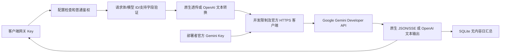

# 官方 API 版本架构

这是可独立部署的 Gemini Developer API 网关，不再依赖旧归档中的 provider 占位函数、生产数据库或认证控制器。

```text
web.py                    正式 ASGI 入口，只加载环境配置和 create_app
src/gateway/settings.py   两把独立 Key、固定官方 origin、超时/并发/请求体限制
src/gateway/app.py        鉴权、路由、共享 HTTPX 客户端、并发槽、生命周期、脱敏失败
src/gateway/protocol.py   文本协议转换、模型 ID 验证、SSE 解码与 OpenAI 分帧
src/gateway/store.py      SQLite 按日汇总，无内容、身份或凭证数据
tests/fixtures.py         纯模拟官方返回与假 Key，仅测试使用
tests/test_gateway.py     无付费调用的完整应用接口契约测试
tests/serve_mock.py       仅测试镜像使用的真实 HTTP 验收入口
Dockerfile               非 root 生产层 + 单独 test 层
compose.yaml             localhost 端口、只读根文件系统、持久化汇总卷
```



## 信任边界

- 生产 URL 常量固定为官方 `generativelanguage.googleapis.com`，使用 TLS 校验且不跟随重定向；不会根据用户字段、模型名称、环境变量或返回 Location 改主机。
- 官方 Key 只发往该主机的 `x-goog-api-key`；客户端 Key 只用于本地比对，不透传、不落库。缺配置或两把 Key 相同无法正常启用服务。
- 工厂 `transport` 参数仅供源码测试注入，不是服务器 HTTP 接口或运行时配置。生产镜像只复制 `src/`、`web.py`、依赖和 LICENSE，不含 `tests/`。
- 本地健康检查不能证明付费凭据有效；`readyz` 也不调用上游。真实账号/计费/模型权限由部署者和 Google 管理。
- 不支持的协议能力明确拒绝；未实现认证绕过、特殊签名、会话提取、账户轮换或自动重试。

## 请求、流和失败

原生接口验证文本消息并保留官方返回。OpenAI 接口映射普通角色、系统指令和生成参数；工具/多模态明确不支持。SSE 解码按事件而不是 TCP chunk 处理，多行 JSON、CRLF 和注释均可解析。正常 OpenAI 流有角色、文本增量、结束原因和 `[DONE]`；请求 `include_usage` 时增加最后的 usage 帧。

开始流之前的连接、状态、内容类型错误通过非 200 响应返回；流中断、格式错误、缺少正常终止信息用错误帧报告，不伪造正常结束。客户端取消时关闭上游响应并释放并发槽。无指数重试或换账户逻辑，避免重复生成和隐藏计费。

## 持久化与运维

SQLite 只存日、固定路由类别、状态和聚合指标，90 天清理。汇总写入失败不会让已完成上游请求变成需要重试的响应。Compose 卷用于持久化，容器非 root、根文件系统只读；不保存用户内容。需要多实例/高并发或多租户时应独立设计，不宣称本版本支持共享账户或租户隔离。

历史静态归档的 60979cd 等版本信息只用于来源记录。本版本是官方 API 方向的独立改写，不能据此声称腾讯云旧服务已经被升级或替换。
